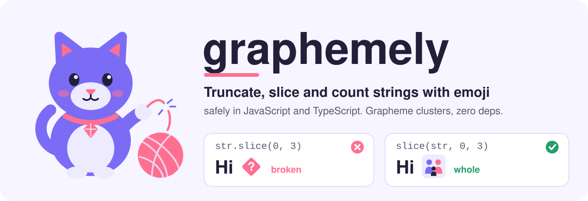

<p align="center">
  <b>English</b> | <a href="README.pt-BR.md">Português (Brasil)</a>
</p>

<p align="center">
  <a href="https://kwy404.github.io/graphemely/">
    <picture>
      <source media="(prefers-color-scheme: dark)" srcset="assets/banner-dark.svg">
      
    </picture>
  </a>
</p>

<h1 align="center">graphemely: truncate, slice and count strings with emoji safely in JavaScript</h1>

<p align="center">
  <a href="https://www.npmjs.com/package/graphemely"></a>
  <a href="https://bundlephobia.com/package/graphemely"></a>
  <a href="https://github.com/kwy404/graphemely/actions/workflows/ci.yml"></a>
  <a href="LICENSE"></a>
  <a href="https://www.typescriptlang.org/"></a>
  
</p>

**graphemely** is a tiny, zero dependency library that counts and cuts JavaScript strings the way people see them. JavaScript string length, `slice`, `substring`, `split('')` and `reverse` work on UTF-16 code units, so the length of an emoji is 2 (or 8, or 14), and `str.slice(0, n)` can cut an emoji in half. graphemely works on **grapheme clusters** instead, so you can truncate a string with emoji, get the real string length with emoji, take a Unicode safe substring and reverse a string without breaking flags, skin tones, family emoji, keycaps, accents (`é` composed or decomposed), Hangul, Thai or Devanagari.

```js
import { length, truncate, slice, reverse } from 'graphemely';

const family = '\u{1F468}\u{200D}\u{1F469}\u{200D}\u{1F467}'; // man, woman, girl joined by zero width joiners

family.length;              // 8   (UTF-16 code units)
length(family);             // 1   (what a person sees)

const str = 'Hi' + family + '!';
str.slice(0, 3);            // 'Hi\uD83D'  a lone surrogate, renders as a broken box
slice(str, 0, 3);           // 'Hi' + family, the whole emoji
truncate(str, 3);           // 'Hi…'
reverse(str);               // '!' + family + 'iH'
```

<table align="center">
  <tr>
    <td align="center" width="33%"><br><b>Real length</b><br>Count graphemes, not code units</td>
    <td align="center" width="33%"><br><b>Truncate</b><br>Ellipsis and word boundaries, never half an emoji</td>
    <td align="center" width="33%"><br><b>Slice and at</b><br>Unicode safe substring with negative indices</td>
  </tr>
  <tr>
    <td align="center"><br><b>Reverse</b><br>Flags and accents stay intact</td>
    <td align="center"><br><b>Split</b><br>Split a string into user visible characters</td>
    <td align="center"><br><b>Pad and wrap</b><br>Fixed width text that lines up</td>
  </tr>
  <tr>
    <td align="center"><br><b>Well formed</b><br>Detect and repair lone surrogates</td>
    <td align="center"><br><b>ESLint plugin</b><br>Catch <code>split('')</code> and unsafe truncation</td>
    <td align="center"><br><b>Tiny</b><br>About 2 kB gzipped, tree shakeable, zero deps</td>
  </tr>
</table>

<p align="center">
  
</p>

## Contents

- [Install](#install)
- [Quick start](#quick-start)
- [API reference](#api-reference)
- [How do I truncate a string with emoji in JavaScript?](#how-do-i-truncate-a-string-with-emoji-in-javascript)
- [Why is the length of an emoji 2?](#why-is-the-length-of-an-emoji-2)
- [How do I reverse a string with emoji in JavaScript?](#how-do-i-reverse-a-string-with-emoji-in-javascript)
- [How do I split a string into characters with Unicode support?](#how-do-i-split-a-string-into-characters-with-unicode-support)
- [Why does substring break emoji?](#why-does-substring-break-emoji)
- [What is a lone surrogate and how do I remove it?](#what-is-a-lone-surrogate-and-how-do-i-remove-it)
- [ESLint plugin](#eslint-plugin)
- [How does graphemely compare to the alternatives?](#how-does-graphemely-compare-to-the-alternatives)
- [Browser and runtime support](#browser-and-runtime-support)
- [Bundle size](#bundle-size)
- [Contributing](#contributing)
- [License](#license)

Guides with live examples: [truncate a string with emoji](https://kwy404.github.io/graphemely/truncate-string-with-emoji.html), [string length with emoji](https://kwy404.github.io/graphemely/string-length-emoji.html), [reverse a string with Unicode](https://kwy404.github.io/graphemely/reverse-string-unicode.html), [split a string into characters](https://kwy404.github.io/graphemely/split-string-into-characters.html), [substring without breaking emoji](https://kwy404.github.io/graphemely/substring-without-breaking-emoji.html), [remove lone surrogates](https://kwy404.github.io/graphemely/lone-surrogates.html). Try it in the [online playground](https://kwy404.github.io/graphemely/#playground).

## Install

```sh
npm install graphemely
```

```sh
pnpm add graphemely
yarn add graphemely
bun add graphemely
```

Deno:

```js
import { truncate } from 'npm:graphemely';
```

Ships ESM and CommonJS builds with TypeScript declarations. No runtime dependencies.

## Quick start

```js
import { graphemes, length, truncate, slice, at, reverse, wrap } from 'graphemely';
// CommonJS: const { truncate } = require('graphemely');

const tweet = 'Ship it \u{1F680}\u{1F680}\u{1F680} with friends \u{1F469}\u{1F3FD}\u{200D}\u{1F4BB}';

length(tweet);                                  // 26, the length a person would count
truncate(tweet, 12);                            // 'Ship it \u{1F680}\u{1F680}\u{1F680}…'
truncate(tweet, 15, { wordBoundary: true });    // 'Ship it \u{1F680}\u{1F680}\u{1F680}…'
truncate(tweet, 12, { ellipsis: '...' });       // 'Ship it \u{1F680}...'
at(tweet, -1);                                  // '\u{1F469}\u{1F3FD}\u{200D}\u{1F4BB}', the whole emoji
graphemes('cafe\u{301}');                       // ['c', 'a', 'f', 'e\u{301}']
wrap('the quick brown fox', 10);                // ['the quick', 'brown fox']
```

In this README, emoji are written as JavaScript escapes such as `\u{1F680}` (a rocket) so the examples stay readable everywhere. In your code you can type them directly.

## API reference

Every function counts in **grapheme clusters** (user perceived characters, as defined by [Unicode UAX #29](https://unicode.org/reports/tr29/)). Indices accept negative values where the native counterpart does.

| Function | Returns | Native equivalent it replaces |
| --- | --- | --- |
| [`graphemes(str)`](#graphemesstr) | `string[]` | `str.split('')`, `[...str]`, `Array.from(str)` |
| [`length(str)`](#lengthstr-and-countstr) | `number` | `str.length` |
| [`count(str)`](#lengthstr-and-countstr) | `number` | alias of `length` |
| [`slice(str, start?, end?)`](#slicestr-start-end) | `string` | `str.slice`, `str.substring` |
| [`at(str, index)`](#atstr-index) | `string \| undefined` | `str.at`, `str[i]`, `str.charAt` |
| [`splitAt(str, index)`](#splitatstr-index) | `[string, string]` | `[str.slice(0, i), str.slice(i)]` |
| [`truncate(str, maxLength, options?)`](#truncatestr-maxlength-options) | `string` | `str.slice(0, n) + '...'` |
| [`reverse(str)`](#reversestr) | `string` | `str.split('').reverse().join('')` |
| [`padStart(str, targetLength, padString?)`](#padstart-and-padend) | `string` | `str.padStart` |
| [`padEnd(str, targetLength, padString?)`](#padstart-and-padend) | `string` | `str.padEnd` |
| [`wrap(str, width, options?)`](#wrapstr-width-options) | `string[]` | hand written word wrap |
| [`isWellFormed(str)`](#iswellformedstr-and-towellformedstr) | `boolean` | `str.isWellFormed` (ES2024) |
| [`toWellFormed(str)`](#iswellformedstr-and-towellformedstr) | `string` | `str.toWellFormed` (ES2024) |

All functions throw a `TypeError` when `str` is not a string.

### `graphemes(str)`

Splits a string into grapheme clusters. Joining the result always gives back the input.

```js
graphemes('\u{1F1E7}\u{1F1F7}\u{1F1FA}\u{1F1F8}'); // two flags: ['\u{1F1E7}\u{1F1F7}', '\u{1F1FA}\u{1F1F8}']
graphemes('1\u{FE0F}\u{20E3}');                  // a keycap: ['1\u{FE0F}\u{20E3}']
graphemes('a\r\nb');                             // ['a', '\r\n', 'b']
```

### `length(str)` and `count(str)`

Number of grapheme clusters. ASCII and Latin-1 text takes a fast path that returns `str.length` directly. `count` is the same function under a name that does not shadow anything.

```js
length('\u{1F44D}\u{1F3FD}');  // 1, thumbs up with a skin tone (4 code units)
length('e\u{301}');            // 1, e plus a combining accent (2 code units)
```

### `slice(str, start?, end?)`

Same contract as `String.prototype.slice`, measured in graphemes. Negative indices count from the end, out of range indices are clamped.

```js
slice('I \u{2764}\u{FE0F} JS', 0, 3); // 'I \u{2764}\u{FE0F}' (native slice drops the variation selector)
slice('hello', -3);                   // 'llo'
```

### `at(str, index)`

The grapheme at `index`, or `undefined` when out of range. `-1` is the last grapheme.

### `splitAt(str, index)`

Splits into `[before, after]` at a grapheme index. `before + after === str` always holds.

### `truncate(str, maxLength, options?)`

Shortens text to at most `maxLength` graphemes and appends an ellipsis when it had to cut.

| Option | Default | Description |
| --- | --- | --- |
| `ellipsis` | `'…'` (U+2026, one character) | Appended when the text is cut. **Counts toward `maxLength`**, so the result always fits. |
| `wordBoundary` | `false` | Cut at the last whitespace that fits and drop trailing spaces. Falls back to a hard cut when a single word is longer than the room left. |

If the ellipsis leaves no room for text (`length(ellipsis) >= maxLength`), the text is cut to `maxLength` graphemes without an ellipsis. Throws a `RangeError` for a negative or `NaN` `maxLength`.

```js
truncate('Hello world', 8);                         // 'Hello w…'
truncate('Hello world', 8, { wordBoundary: true }); // 'Hello…'
truncate('Hello world', 8, { ellipsis: '...' });    // 'Hello...'
truncate('Hello', 10);                              // 'Hello' (unchanged)
```

### `reverse(str)`

Reverses by grapheme, so `reverse('cafe\u{301}')` is `'e\u{301}fac'` and flags keep their two regional indicators in order.

### `padStart` and `padEnd`

Like the native methods, but `targetLength` is measured in graphemes and a multi grapheme `padString` is repeated and cut on grapheme boundaries.

```js
'\u{1F600}'.padStart(3);  // ' \u{1F600}'  (one space: the emoji already "counts" as 2)
padStart('\u{1F600}', 3); // '  \u{1F600}' (two spaces)
padStart('7', 3, '0');    // '007'
```

### `wrap(str, width, options?)`

Word wraps text into lines of at most `width` graphemes and returns the lines as an array. Existing line breaks are kept, runs of spaces and tabs between words collapse to one space. With `{ hard: true }`, words longer than `width` are broken between graphemes; otherwise they stay whole on their own line. Width is counted in graphemes, not terminal columns.

```js
wrap('the quick brown fox', 10);              // ['the quick', 'brown fox']
wrap('abcdefgh', 3, { hard: true });          // ['abc', 'def', 'gh']
```

### `isWellFormed(str)` and `toWellFormed(str)`

Detect and repair lone surrogates (half of an emoji left behind by code unit slicing). `toWellFormed` replaces each one with U+FFFD. They match the ES2024 methods and work on every runtime, including Node 16 to 18 and older browsers that lack them.

```js
isWellFormed('\u{1F600}'.slice(0, 1));  // false
toWellFormed('ok\uD83D');               // 'ok\u{FFFD}'
```

## How do I truncate a string with emoji in JavaScript?

The usual `str.slice(0, n) + '...'` counts UTF-16 code units. If the cut lands inside an emoji you get a lone surrogate (a broken box, and an error in `encodeURIComponent`), and even when it does not, it can split a flag, drop a skin tone or separate a family emoji into single people. Use `truncate`:

```js
import { truncate } from 'graphemely';

truncate(title, 60);                             // '…' counts toward the 60
truncate(title, 60, { wordBoundary: true });     // do not cut words in half
truncate(title, 60, { ellipsis: '...' });        // three dots instead
```

More details and a live demo: [How to truncate a string with emoji in JavaScript](https://kwy404.github.io/graphemely/truncate-string-with-emoji.html).

## Why is the length of an emoji 2?

`String.prototype.length` returns the number of UTF-16 code units. Characters outside the Basic Multilingual Plane, including most emoji, need two code units (a surrogate pair), so `'\u{1F600}'.length === 2`. Many emoji are sequences of several code points: a thumbs up with a skin tone is 4 code units, a flag is 4, a family of three joined with zero width joiners is 8, and the England flag (a tag sequence) is 14. `[...str].length` counts code points, which fixes the surrogate pair case but still counts the family as 5. `length(str)` counts grapheme clusters and returns 1 for all of them.

```js
import { length } from 'graphemely';

'\u{1F600}'.length;                    // 2
[...'\u{1F44D}\u{1F3FD}'].length;      // 2
length('\u{1F44D}\u{1F3FD}');          // 1
```

Read more: [String length with emoji in JavaScript](https://kwy404.github.io/graphemely/string-length-emoji.html).

## How do I reverse a string with emoji in JavaScript?

`str.split('').reverse().join('')` reverses code units, so every emoji turns into two lone surrogates. `[...str].reverse().join('')` keeps code points together, but it still reverses the inside of sequences: the two regional indicators of a flag swap (a different flag or none at all), and a combining accent jumps to the previous letter. `reverse(str)` reverses whole grapheme clusters.

```js
import { reverse } from 'graphemely';

reverse('a\u{1F1E7}\u{1F1F7}b'); // 'b\u{1F1E7}\u{1F1F7}a', the flag of Brazil survives
```

Read more: [Reverse a string with Unicode and emoji](https://kwy404.github.io/graphemely/reverse-string-unicode.html).

## How do I split a string into characters with Unicode support?

`split('')` splits into code units, and `Array.from(str)` or `[...str]` split into code points. Neither gives you what a person calls a character. `graphemes(str)` does, and it uses `Intl.Segmenter` under the hood when the runtime has it.

```js
import { graphemes } from 'graphemely';

graphemes('\u{D55C}\u{AE00}');        // Hangul: 2 syllables
graphemes('\u{E19}\u{E49}\u{E33}');   // Thai "water": 1 grapheme, 3 code points
```

Read more: [Split a string into characters in JavaScript](https://kwy404.github.io/graphemely/split-string-into-characters.html).

## Why does substring break emoji?

`substring`, `substr` and `slice` take code unit indices. Any index that falls between the two halves of a surrogate pair, or between the parts of an emoji sequence, cuts the character. `slice(str, start, end)` takes grapheme indices, so every possible cut is safe.

Read more: [Substring without breaking emoji](https://kwy404.github.io/graphemely/substring-without-breaking-emoji.html).

## What is a lone surrogate and how do I remove it?

A lone surrogate is half of a surrogate pair, usually left behind by cutting a string with `slice` or `substring`. It renders as a replacement box, makes `encodeURIComponent` throw a `URIError`, and is replaced with U+FFFD by `TextEncoder`. Check with `isWellFormed(str)` and repair with `toWellFormed(str)`.

Read more: [Remove lone surrogates from a JavaScript string](https://kwy404.github.io/graphemely/lone-surrogates.html).

## ESLint plugin

graphemely ships an ESLint plugin (flat config, ESLint 8.57 or newer) that finds the unsafe patterns in your code base. ESLint is an optional peer dependency.

```js
// eslint.config.js
import graphemely from 'graphemely/eslint-plugin';

export default [
  graphemely.configs.recommended,
];
```

Or pick rules yourself:

```js
import graphemely from 'graphemely/eslint-plugin';

export default [
  {
    plugins: { graphemely },
    rules: {
      'graphemely/no-unsafe-string-split': 'error',
      'graphemely/no-unsafe-reverse': 'error',
      'graphemely/prefer-graphemely-truncate': 'warn',
    },
  },
];
```

| Rule | Flags | Docs |
| --- | --- | --- |
| `no-unsafe-string-split` | `str.split('')` | [docs](docs/rules/no-unsafe-string-split.md) |
| `no-unsafe-reverse` | `str.split('').reverse()`, `[...str].reverse().join('')`, `Array.from(str).reverse().join('')` | [docs](docs/rules/no-unsafe-reverse.md) |
| `prefer-graphemely-truncate` | `str.slice(0, n) + '...'` and the `substring`, `substr` and template literal forms (conservative heuristic) | [docs](docs/rules/prefer-graphemely-truncate.md) |

All three are enabled as warnings in `configs.recommended`.

## How does graphemely compare to the alternatives?

| | graphemely | `Intl.Segmenter` directly | [grapheme-splitter](https://www.npmjs.com/package/grapheme-splitter) | [graphemer](https://www.npmjs.com/package/graphemer) | lodash `_.truncate` |
| --- | --- | --- | --- | --- | --- |
| Grapheme clusters per UAX #29 | yes | yes | yes, rules from 2018 | yes | approximation |
| Truncate, slice, pad, wrap, reverse | yes | write it yourself | no | no | truncate only |
| Works without `Intl.Segmenter` | built-in fallback | no | yes | yes | yes |
| Size, minified and gzipped | about 2 kB | 0 (built in) | 7.7 kB | 14.9 kB | 2.9 kB |
| Last release | 2026 | n/a | September 2018 | September 2022 | maintained |
| TypeScript types | built in | built in | built in | built in | separate package |

Notes, all checked against the packages on npm:

- **grapheme-splitter** 1.0.4 has not been released since 2018, so it does not know about newer Unicode rules. **graphemer** is a maintained fork that ships its own Unicode tables, which is why it is larger. Both only split and count.
- **`Intl.Segmenter`** is what graphemely uses when available. Using it directly is perfectly fine, but it is verbose (`Array.from(new Intl.Segmenter(undefined, { granularity: 'grapheme' }).segment(str), (s) => s.segment)`), and you still have to write truncation, ellipsis and word boundary logic yourself, and handle runtimes where it is missing.
- **lodash** `_.truncate` and `_.size` are smarter than plain code units: they use a regular expression that understands surrogate pairs, combining marks and emoji ZWJ sequences. It is still an approximation. With lodash 4.18.1 it splits a Hangul syllable written with conjoining jamo, counts the Thai word for water as 3 characters, counts the England flag as 7 and `\r\n` as 2. graphemely gets all of these right.

## Browser and runtime support

| Runtime | Uses |
| --- | --- |
| Node.js 16 and newer | `Intl.Segmenter` |
| Chrome and Edge 87+, Safari 14.1+, Firefox 125+ | `Intl.Segmenter` |
| Deno, Bun, Cloudflare Workers | `Intl.Segmenter` |
| Older browsers and runtimes without `Intl.Segmenter` | built-in fallback |

The fallback implements the UAX #29 rules that matter in practice (CR LF, controls, Hangul syllables, combining and spacing marks, zero width joiner emoji sequences, variation selectors, emoji modifiers, tag sequences and regional indicator pairs). It skips the rare Prepend rule and the Unicode 15.1 Indic conjunct rule, so a few Devanagari conjuncts may split into two graphemes where the newest `Intl.Segmenter` keeps one. The output is ES2020.

## Bundle size

Measured with esbuild (minified) and zlib for version 0.1.0, run `npm run size` to reproduce:

| Import | Minified | Gzip | Brotli |
| --- | --- | --- | --- |
| everything | 4.1 kB | 2.0 kB | 1.8 kB |
| `{ truncate }` only | 2.5 kB | 1.3 kB | 1.2 kB |
| `{ isWellFormed }` only | 1.0 kB | 0.6 kB | 0.5 kB |

The package is marked `sideEffects: false`, so bundlers drop what you do not import. The ESLint plugin lives in a separate entry point and never ends up in your app bundle.

## Contributing

Issues and pull requests are welcome. See [CONTRIBUTING.md](CONTRIBUTING.md). In short:

```sh
npm install
npm test          # vitest, includes the fallback segmenter and the ESLint rules
npm run lint
npm run typecheck
npm run build
```

## License

[MIT](LICENSE) © 2026 [Alexandre Kohler](https://github.com/kwy404). Mascot Gem and artwork are part of the project and share the same license.
